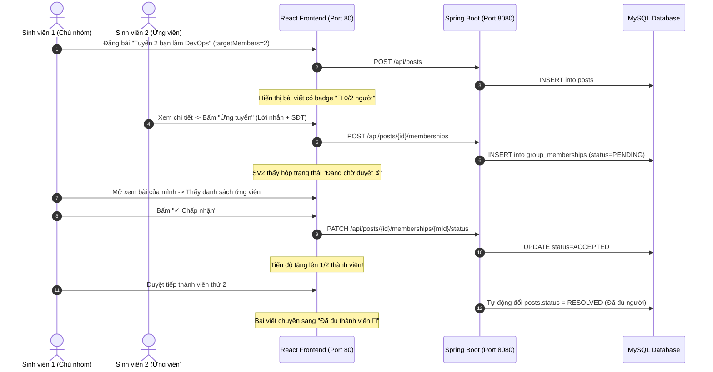

# KỊCH BẢN CHẠY DEMO & BÁO CÁO BẢO VỆ MINI PROJECT DEVOPS (SESSION 13)
**Học phần:** DevOps (IT209)  
**Đề tài:** Nâng cấp & Tự động hóa triển khai nền tảng Campus Hub (Tìm nhóm học tập)  
**Nhóm thực hiện:** Nhóm DevOps Session 13 (10 thành viên)  
**Thời lượng bảo vệ:** 30 – 35 phút  

---

## PHẦN 1: HƯỚNG DẪN THIẾT LẬP & KHỞI CHẠY DEMO

Để buổi bảo vệ diễn ra trơn tru không gặp sự cố mạng hay kết nối, nhóm chuẩn bị sẵn **2 phương án chạy**:

### Cách 1: Khởi chạy bằng Docker Compose (Khuyên dùng khi chiếu máy tính trên lớp)
Mở terminal PowerShell tại thư mục gốc của dự án:
```powershell
# 1. Khởi tạo file môi trường (nếu chưa có)
copy .env.example .env

# 2. Khởi chạy toàn bộ full-stack (MySQL + Backend + Frontend Nginx)
docker compose up --build -d

# 3. Kiểm tra xem 3 container đã UP khỏe mạnh chưa
docker compose ps
```
**Mở trình duyệt kiểm tra:**
- **Giao diện Web:** `http://localhost` (Port 80)
- **Kiểm tra Healthcheck:** `http://localhost:8080/actuator/health` (Trả về `{"status":"UP"}`)

### Cách 2: Khởi chạy bằng lệnh dev cục bộ (Dự phòng trường hợp máy không bật Docker)
* **Terminal 1 (Backend):**
  ```powershell
  cd backend
  ./gradlew.bat bootRun
  ```
* **Terminal 2 (Frontend):**
  ```powershell
  cd frontend
  npm run dev
  ```
* **Mở trình duyệt tại:** `http://localhost:5173`

---

## PHẦN 2: KỊCH BẢN CHẠY DEMO TỪNG BƯỚC (LIVE DEMO)

> [!TIP]
> **Mẹo chuẩn bị trước khi demo:** Mở sẵn **2 trình duyệt song song** trên màn hình máy chiếu:
> - **Cửa sổ thường:** Đóng vai trò là **Trưởng nhóm (Người tuyển)**.
> - **Cửa sổ ẩn danh (Incognito):** Đóng vai trò là **Ứng viên (Sinh viên xin vào nhóm)**.



### 5 Bước thao tác trực tiếp trên màn hình chiếu:

#### Bước 1: Tạo bài tuyển nhóm
1. Tại Cửa sổ thường, đăng nhập tài khoản: `student` / `student123`.
2. Bấm nút **"Đăng bài"**, chọn chuyên mục **"Tìm nhóm"**.
3. Điền thông tin:
   - **Tiêu đề:** `"Cần tìm 2 bạn làm bài tập lớn DevOps Session 13"`
   - **Nội dung:** `"Nhóm mình đã có 1 bạn làm backend, cần tìm thêm 2 bạn cùng làm Docker và CI/CD."`
   - **Số lượng thành viên cần tìm:** Nhập **`2`**.
4. Bấm **"Đăng bài"**.
5. *Chỉ cho thầy thấy:* Trên trang chủ xuất hiện ngay thẻ bài viết với huy hiệu **`👥 0/2 người`**.

#### Bước 2: Sinh viên khác gửi đơn ứng tuyển
1. Chuyển sang Cửa sổ ẩn danh, đăng ký tài khoản mới (hoặc đăng nhập `admin` / `admin123`).
2. Bấm xem chi tiết bài đăng vừa tạo.
3. *Chỉ cho thầy thấy:* Thanh tiến độ trực quan hiển thị `Tiến độ tuyển nhóm: 0 / 2 thành viên (Đang tìm kiếm thêm)`.
4. Bấm nút **`✋ Đăng ký tham gia nhóm`**.
5. Hộp thoại `ApplyDialog` mở ra, điền:
   - **Lời nhắn:** `"Mình đã có kiến thức cơ bản về Docker và Git, muốn tham gia nhóm cùng làm bài tập lớn."`
   - **Thông tin liên hệ:** `"Zalo: 0912345678 (Nguyễn Văn B)"`
6. Bấm **"Gửi yêu cầu tham gia"**.
7. *Chỉ cho thầy thấy:* Xuất hiện ngay khung trạng thái: `Đơn đăng ký tham gia nhóm của bạn: Đang chờ duyệt ⏳`.

#### Bước 3: Chủ bài viết xét duyệt ứng viên
1. Quay lại Cửa sổ của `student`, tải lại trang chi tiết bài viết.
2. *Chỉ cho thầy thấy:* Xuất hiện khối quản lý **"Danh sách ứng viên đăng ký tham gia (1)"** (chỉ chủ bài mới thấy khối này).
3. Hiển thị đầy đủ tên ứng viên, lời nhắn và số Zalo liên hệ.
4. Bấm nút **`✓ Chấp nhận`**.
5. Thanh tiến độ tự động cập nhật: **`1 / 2 thành viên`**.

#### Bước 4: Demo tự động chốt nhóm khi đủ chỉ tiêu
1. Tạo thêm một tài khoản sinh viên thứ 3 ứng tuyển và chủ bài bấm **`✓ Chấp nhận`**.
2. Khi số thành viên được duyệt đạt `2 / 2`:
   - Hệ thống tự động cập nhật bài viết sang trạng thái: **`RESOLVED (🎉 Đã đủ thành viên)`**.
   - Nút ứng tuyển tự động đóng lại để ngăn chặn đơn rác.

#### Bước 5: Demo bắt lỗi và bảo mật (Xử lý ngoại lệ)
1. Dùng tài khoản `student` (chủ bài) cố tình tự ứng tuyển bài của chính mình.
2. Hệ thống chặn ngay lập tức và hiển thị thông báo lỗi thân thiện: `"Bạn là chủ bài đăng, không thể tự ứng tuyển"`.

---

## PHẦN 3: KỊCH BẢN THUYẾT TRÌNH BẢO VỆ (30–35 PHÚT)

Thời lượng bảo vệ được chia đều cho 10 thành viên (khoảng 3 phút/người):

| Thời gian | Thành viên trình bày | Nội dung báo cáo trọng tâm |
| :---: | :--- | :--- |
| **00:00 - 03:00** | **Phạm Hương Quỳnh** *(Trưởng nhóm)* | • Giới thiệu thành viên nhóm và phân công vai trò.<br>• Nêu bối cảnh bài toán: Khó khăn của sinh viên khi tìm bạn làm bài tập lớn.<br>• Tóm tắt giải pháp và kiến trúc hệ thống tổng thể. |
| **03:00 - 06:00** | **Trần Thị Thu Trang** | • Trình bày User Flow (luồng người dùng từ đăng bài đến chốt nhóm).<br>• Giải thích thiết kế giao diện UI/UX và các trường hợp lỗi được xử lý. |
| **06:00 - 09:00** | **Phạm Minh Tuấn** | • Trình bày mô hình CSDL (ERD), bảng `group_memberships`.<br>• Giải thích cơ chế di trú CSDL tự động bằng Flyway (`V2__add_group_membership.sql`). |
| **09:00 - 12:00** | **Tô Anh Tuấn** | • Trình bày kiến trúc Backend Spring Boot (Java 21).<br>• Trình bày 4 REST API mới và thuật toán tự động chuyển trạng thái `RESOLVED`. |
| **12:00 - 15:00** | **Đỗ Tiến Đạt** | • Trình bày các thành phần React Component: `PostCard`, thanh tiến độ `PostDetail`, form validation. |
| **15:00 - 18:00** | **Ngô Trung Chiến** | • Trình bày bảng điều khiển duyệt ứng viên cho chủ nhóm, CSS Responsive trên Mobile/Desktop. |
| **18:00 - 21:00** | **Đặng Thanh Bình** | • Trình bày kết quả kiểm thử tự động Backend (5/5 tests passed bằng MockMvc) và kết quả chạy ESLint. |
| **21:00 - 24:00** | **Vũ Đức Huy Hoàng** | • Trình bày kỹ thuật Docker Multi-stage build (tối ưu image JRE 21, non-root user `spring`) và Nginx Reverse Proxy. |
| **24:00 - 27:00** | **Đỗ Đức Mạnh** | • Trình bày điều phối `docker-compose.yml`, kiểm tra healthcheck MySQL và quy trình CI/CD GitHub Actions. |
| **27:00 - 30:00** | **Cao Chí Thiện** | • **THỰC HIỆN DEMO TRỰC TIẾP** 5 bước trên máy chiếu.<br>• Trình diễn endpoint giám sát `/actuator/health`. |
| **30:00 - 35:00** | **Cả nhóm** | • Trả lời các câu hỏi phản biện của Thầy giáo và các nhóm khác. |

---

## PHẦN 4: 5 CÂU HỎI THẦY THƯỜNG HỎI & CÁCH TRẢ LỜI CHUẨN 10/10

### Câu hỏi 1: "Tại sao nhóm dùng Nginx làm Reverse Proxy mà không để React gọi trực tiếp sang cổng 8080 của Spring Boot?"
> **Trả lời:** "Dạ thưa thầy, sử dụng Nginx làm Reverse Proxy mang lại 3 lợi ích lớn theo chuẩn DevOps:
> 1. **Giải quyết triệt để lỗi CORS:** Cả frontend và API đều chạy chung trên cổng 80 (`/` phục vụ HTML/JS, `/api/` chuyển tiếp vào backend), trình duyệt không bị chặn chính sách Same-Origin.
> 2. **Hiệu năng:** Nginx phục vụ các tệp tĩnh (HTML, CSS, JS) nhanh hơn Tomcat rất nhiều lần.
> 3. **Bảo mật:** Giấu kín cổng nội bộ 8080 của backend, chỉ để lộ cổng 80/443 ra môi trường công khai."

### Câu hỏi 2: "Cơ chế Flyway Migration có tác dụng gì trong DevOps?"
> **Trả lời:** "Dạ thưa thầy, Flyway giúp quản lý phiên bản cơ sở dữ liệu (Database Versioning) như Git quản lý mã nguồn. Khi triển khai tự động qua Docker hoặc CI/CD, hệ thống tự động chạy file `V2__add_group_membership.sql` để tạo bảng mà không cần con người phải can thiệp import database bằng tay, tránh sai sót dữ liệu giữa môi trường phát triển và máy chủ thực tế."

### Câu hỏi 3: "Tại sao trong Dockerfile Backend nhóm lại dùng Multi-stage build và tạo thêm user `spring`?"
> **Trả lời:** "Dạ thưa thầy:
> - **Multi-stage build:** Stage 1 dùng JDK để biên dịch mã nguồn, nhưng Stage 2 chỉ dùng JRE siêu nhẹ để chạy file JAR. Điều này giúp giảm dung lượng image từ ~800MB xuống chỉ còn ~250MB, giúp quá trình pull/push và deploy diễn ra rất nhanh.
> - **Tạo user `spring` (non-root):** Đây là tiêu chuẩn bảo mật container (Least Privilege). Mặc định container chạy bằng quyền root, nếu mã nguồn bị lỗ hổng RCE thì hacker có thể chiếm quyền điều khiển toàn bộ máy chủ. Chạy bằng user thường sẽ vô hiệu hóa rủi ro này."

### Câu hỏi 4: "Nếu nhiều người cùng bấm ứng tuyển cùng một lúc vào vị trí cuối cùng thì hệ thống có bị quá tải chỉ tiêu không?"
> **Trả lời:** "Dạ thưa thầy, hệ thống đã được bảo vệ ở cả 2 tầng:
> - **Tầng Logic:** Trong `PostService.java`, trước khi lưu đơn hoặc duyệt đơn, phương thức được đặt trong `@Transactional` và kiểm tra lại số lượng `ACCEPTED` thực tế trong database.
> - **Tầng Cơ sở dữ liệu:** Có ràng buộc `UNIQUE(post_id, user_id)` để ngăn 1 người gửi trùng lặp, và bài viết tự động chuyển sang `RESOLVED` khi duyệt đủ số lượng."

### Câu hỏi 5: "Quy trình CI/CD qua GitHub Actions của nhóm hoạt động như thế nào?"
> **Trả lời:** "Dạ thưa thầy, file `.github/workflows/ci.yml` được kích hoạt tự động mỗi khi có code đẩy lên nhánh `main`. Pipeline gồm 3 bước:
> 1. Chạy `./gradlew test` để đảm bảo logic backend không bị vỡ.
> 2. Chạy `npm run lint` và `npm run build` để kiểm tra chuẩn cú pháp frontend.
> 3. Kiểm thử đóng gói `docker build` cho cả 2 image. Nếu có bất kỳ bước nào lỗi, hệ thống sẽ cảnh báo đỏ và ngăn không cho phiên bản lỗi được phát hành."
